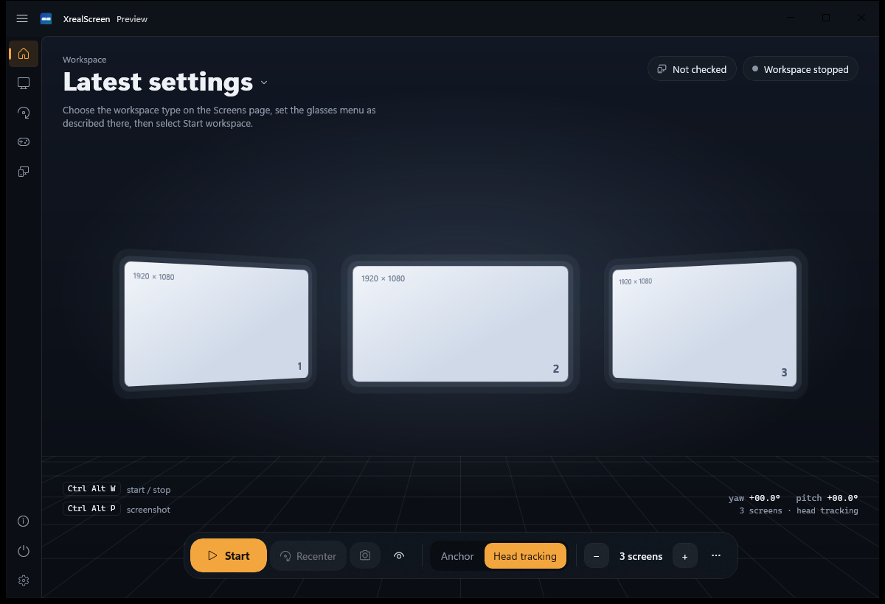
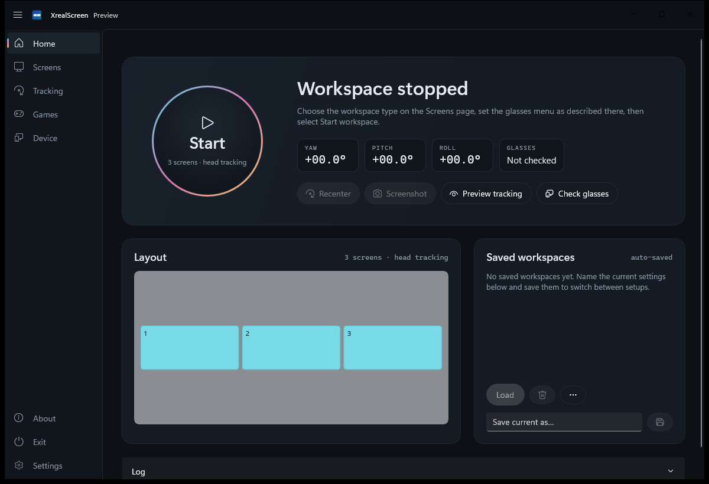
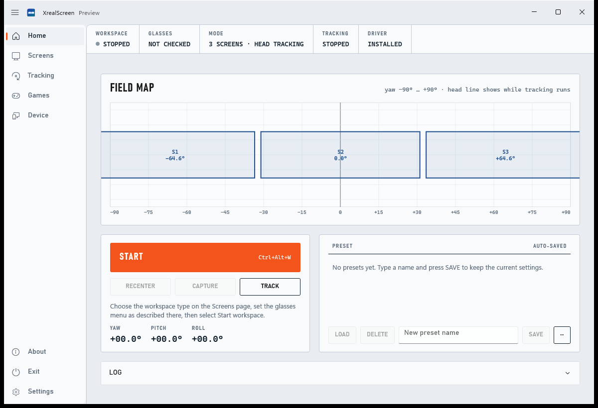
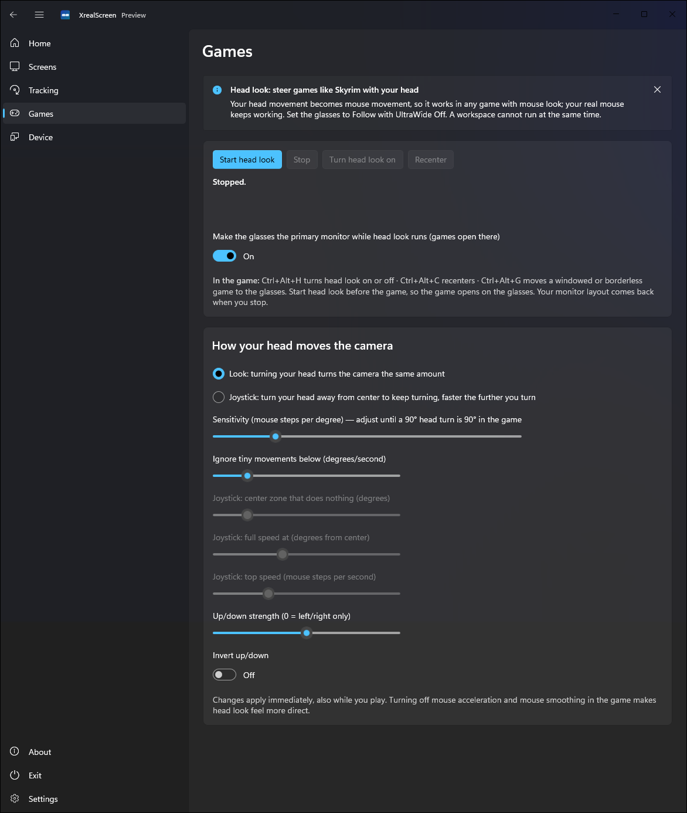

# XrealScreen


*A glasses-anchor workspace. Black areas are see-through in the glasses.*

Turn XREAL One, One Pro, and 1S glasses into a Windows 11 multi-monitor workspace. Up to three pixel-sharp virtual screens held still by the glasses, or head-tracked curved screens. Real Windows monitors, saved workspaces, and your desktop restored when you stop.

Built for everyday coding: a compiler, an editor, and a browser, each on its own screen, with text that stays readable.

## What you get

- **Glasses anchor.** The glasses hold one UltraWide image still (OSD Anchor + UltraWide 32:9, 21:9, or 16:18). XrealScreen splits that image into 1–3 screens at the glasses' own pixels, with an adjustable gap and shape. This is the coding layout.
- **App head tracking.** Up to six curved screens in an arc or a grid. The app reads the glasses' IMU at about 1000 Hz, fuses it, and draws the panels in 3D. Distance, curvature, stabilizer strength, tracking axes, and recenter are settings. Turn the glasses' own Stabilizer off for this mode, or the picture moves twice.
- **Real Windows monitors.** You drag windows onto them the same way as a physical display. Stopping the workspace, or `xrs recover` after a crash, puts your previous monitors and refresh rates back.
- **Saved workspaces.** Save, load, delete, import, and export. Settings reload at start. A workspace can start with the app, with Windows, or when the glasses are plugged in.
- **Primary screen.** Any virtual screen can be the Windows primary monitor while the workspace runs.
- **Screenshots.** Home, the tray, or Ctrl+Alt+P saves what the glasses show to `Pictures\XrealScreen`.
- **Head look for games.** The Games page turns head movement into mouse movement (Look or Joystick). Ctrl+Alt+H toggles it, Ctrl+Alt+C recenters, Ctrl+Alt+G moves the active window to the glasses.
- **Four looks.** Stage (default), Lens, Instrument, and Classic. Switch them live under Settings.
- **A developer tool and an API.** `xrs` probes the glasses, lists monitors, captures a desktop, and recovers a crashed session. `XrealScreen.Sdk` reads the head pose. A JSON-RPC pipe controls a running app from any language.

## Checked on this PC

Windows 11, .NET SDK 10.0.402, 16 October 2026. Details are in [docs/findings/arrealone-pc.md](docs/findings/arrealone-pc.md).

| Check | Result |
| --- | --- |
| `dotnet test --solution XrealScreen.slnx -p:Platform=x64` | 169 passed |
| WinUI app build | Succeeded, 0 warnings |
| Desktop capture | `xrs capture test` on a 3840×2160 monitor. `--png` writes the first frame. The UI text in that frame is sharp. |
| Virtual display driver | Version 0.4.0.1 installed. A 1920×1080 virtual monitor was created, then removed. The laptop and the BenQ came back as they were. |
| Glasses | XREAL One on `\\.\DISPLAY3`, 3840×1080 @ 60 Hz. A 3-screen glasses-anchor workspace ran at 59.5 fps, then the laptop, BenQ, and glasses came back. The USB head-tracking link was down again after that run. |

## Glasses menu

| Workspace | On the glasses |
| --- | --- |
| Glasses anchor | **Anchor**, and **UltraWide** 32:9, 21:9, or 16:18 |
| App head tracking | **Follow**, UltraWide **off**, Stabilizer **off** |

## How it works

The glasses connect over USB-C. Windows sees a normal monitor for the picture. Head tracking arrives on the glasses' USB network adapter (`169.254.2.1`, IMU on TCP port 52998). No XREAL Eye camera is used.

XrealScreen creates the extra monitors with [virtual-display-rs](https://github.com/MolotovCherry/virtual-display-rs) 0.4, an Indirect Display Driver. It captures them with Windows.Graphics.Capture and draws them with Direct3D 11. Glasses-anchor mode places the screens into the glasses' anchored UltraWide image. App head tracking draws curved panels from the fused pose.

The driver package in this tree is signed with a test certificate created on the build machine. Installing it trusts that certificate in the machine Root and TrustedPublisher stores. Windows test-signing mode is not required and is not turned on. The private key is not in git.

Architecture: [docs/ARCHITECTURE.md](docs/ARCHITECTURE.md). Current milestone notes: [docs/STATUS.md](docs/STATUS.md).

## Build and run

Requirements: Windows 11, .NET SDK 10.0.401 or newer, Windows SDK 10.0.26100.

```powershell
dotnet build XrealScreen.slnx -p:Platform=x64
dotnet test --solution XrealScreen.slnx -p:Platform=x64
dotnet run --project src/XrealScreen.App -p:Platform=x64
```

The app is an MSIX package. Run it with `dotnet run`, from Visual Studio with the **XrealScreen.App (Package)** profile, or from the Start menu after install. Starting the bare `.exe` fails. Do not rebuild the app project while a workspace is running. If Windows closes the app, `xrs recover` restores the monitors.

The virtual display driver is built with `installer\driver\Build-Driver.ps1` (Rust, WDK 10.0.26100, LLVM 18) and installed with `installer\Install-Driver.ps1`. See [installer/README.md](installer/README.md).

## `xrs`

```powershell
dotnet run --project tools/XrealScreen.Cli -p:Platform=x64 -- probe
dotnet run --project tools/XrealScreen.Cli -p:Platform=x64 -- display list
dotnet run --project tools/XrealScreen.Cli -p:Platform=x64 -- capture test \\.\DISPLAY2 --png $env:TEMP\desktop.png
dotnet run --project tools/XrealScreen.Cli -p:Platform=x64 -- vdd state
dotnet run --project tools/XrealScreen.Cli -p:Platform=x64 -- recover
```

`capture test --png` saves the first Windows.Graphics.Capture frame. That is how the 3840×2160 desktop check was made. Frames are not written unless you pass `--png` or use the screenshot command.

## Screenshots

**Looks.** Pick one under Settings.

| Stage (default) | Lens | Instrument |
| --- | --- | --- |
|  |  |  |

The pages below use the Classic look.

| Home | Screens |
| --- | --- |
|  |  |

| Tracking | Settings |
| --- | --- |
|  |  |

**Games**



## Developers

- [.NET SDK](docs/sdk/dotnet-sdk.md) (`XrealScreen.Sdk`): pose stream at about 1000 Hz, reconnect, head-to-mouse. The app does not have to be running.
- [Local API](docs/sdk/local-api.md): JSON-RPC 2.0 on `\\.\pipe\XrealScreen.Api`.
- Samples live in [`samples/`](samples/). Pack the NuGet packages with `.\tools\Pack-Sdk.ps1`.

```csharp
var glasses = new XrealGlasses();
await foreach (var pose in glasses.ReadPosesAsync(ct))
    Console.WriteLine($"yaw {pose.Yaw:F1}  pitch {pose.Pitch:F1}");
```

## License

MIT. See [LICENSE](LICENSE) and [THIRD-PARTY-NOTICES.md](THIRD-PARTY-NOTICES.md). Not affiliated with or endorsed by XREAL.
